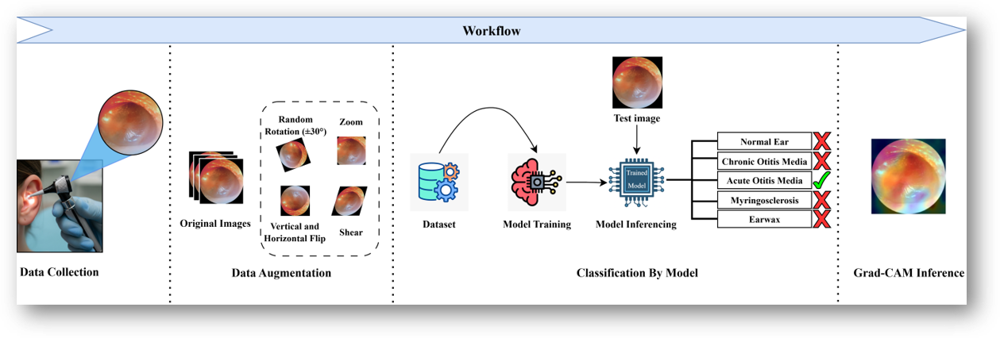
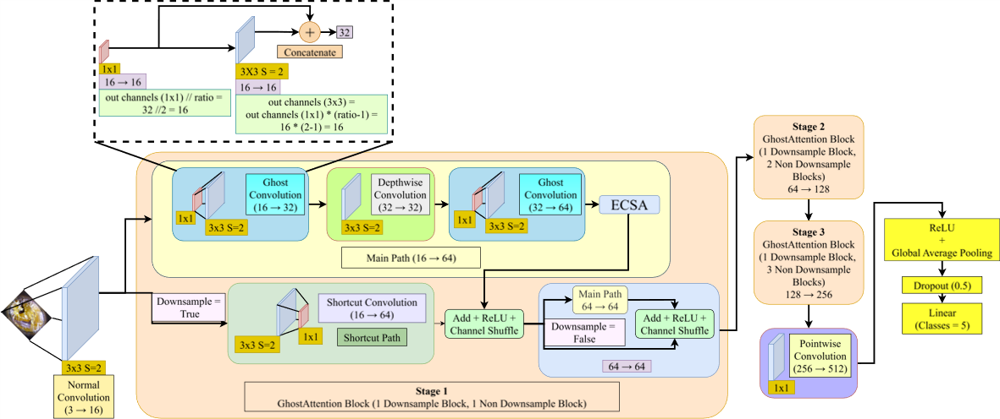
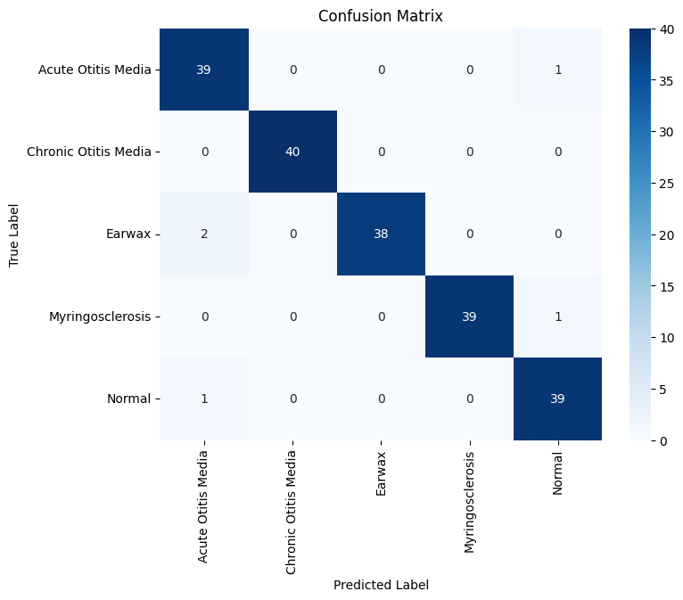
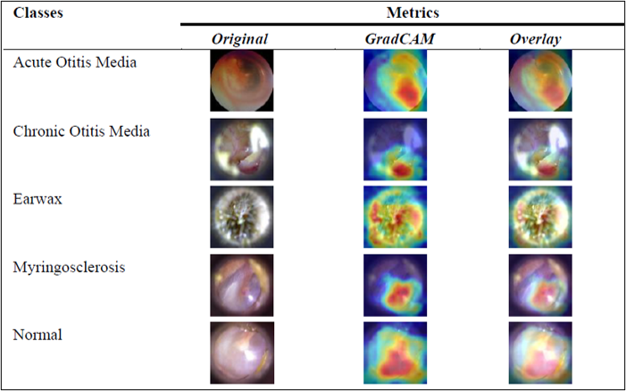

# OtoScopeNet: An Efficient and Attention-Driven Deep Learning Framework for Robust Diagnosis of Ear Diseases

[](https://doi.org/10.1007/978-3-032-27117-4_26)

> **Conference:** Presented at the 5th International Conference on Advanced Network Technologies and Intelligent Computing (ANTIC 2025).
> **Grants/Awards:** Recipient of the Industry Sponsored Registration Grant, rewarded by the Department of Science and Technology (DST), Government of India.

## Overview
Manual otoscopy is often time-intensive and limited by clinician expertise, leading to potential misclassifications. This repository contains the official PyTorch implementation of **OtoScopeNet**, a lightweight Convolutional Neural Network (CNN) engineered for the high-accuracy classification of otoscopic images under severe computational constraints. 

The model serves as a highly efficient diagnostic tool tailored for edge-device deployment, enabling rapid, preliminary patient assessments prior to clinical intervention. OtoScopeNet performs classification across five distinct ear pathology classes: Acute Otitis Media, Chronic Otitis Media, Earwax, Myringosclerosis, and Normal.

*(Note: The clinical dataset utilized for model training is proprietary and has been excluded from this repository to maintain data privacy.)*

## Proposed Methodology
The clinical workflow encompasses data collection, real-time augmentation (including rotation, flipping, and color jittering), classification via the OtoScopeNet architecture, and interpretability mapping.

<div align="center">
  
  <br>
  <em>Figure 1: Complete pipeline from clinical data collection to classification and Grad-CAM inference.</em>
</div>

## Model Architecture
OtoScopeNet was developed with an emphasis on hardware constraints, significantly lowering the parameter count and GFLOPs without sacrificing representational capacity. The network utilizes the following core mechanisms:
* **Ghost Modules:** Synthesize supplementary feature maps using computationally inexpensive depthwise operations.
* **Efficient Channel and Spatial Attention (ECSA):** Recalibrates information to focus on discriminative features.
* **Channel Shuffling:** Facilitates robust cross-group information transfer.

<div align="center">
  
  <br>
  <em>Figure 2: The OtoScopeNet CNN framework, highlighting the conditional GhostAttention blocks and ECSA mechanisms.</em>
</div>

## Results & Performance Metrics
Evaluated against a balanced dataset of clinical images, the model demonstrates highly robust diagnostic capabilities suitable for low-power mobile devices.

* **Test Accuracy:** 97%
* **Macro F1-Score:** 0.98
* **Total Parameters:** 352,494
* **Model Size:** 1.50 MB
* **Computational Demand:** 0.28 GFLOPS
* **Inference Speed:** 0.466 ms per image

<div align="center">
  
  <br>
  <em>Figure 3: Confusion matrix on the test set, demonstrating minimal misclassification overlap between pathologies.</em>
</div>

## Interpretability with Grad-CAM
To validate the clinical relevance of the model's decision-making process, Gradient-weighted Class Activation Mapping (Grad-CAM) was applied. The heatmaps confirm that OtoScopeNet correctly isolates and relies on medically relevant pathological features rather than arbitrary background noise.

<div align="center">
  
  <br>
  <em>Figure 4: Grad-CAM overlay comparison highlighting the spatial regions of importance driving the model's predictions.</em>
</div>

## Citation
If you find this code or research helpful in your work, please consider citing the paper:

```bibtex
@inproceedings{bundawala2025otoscopenet,
  title={OtoscopeNet: An Efficient and Attention-Driven Deep Learning Framework for Robust Diagnosis of Ear Diseases},
  author={Bundawala, Manomay and Tripathy, Aditya and Kaushal, Abhishek and Mishra, Anupam and Dutta, Malay Kishore},
  booktitle={5th International Conference on Advanced Network Technologies and Intelligent Computing (ANTIC)},
  year={2025},
  doi={10.1007/978-3-032-27117-4_26}
}